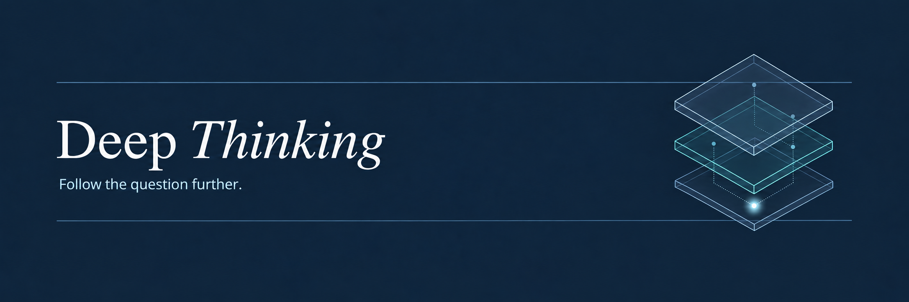

<p align="center">
  
</p>

<p align="center">
  <strong>Stay with the question. Go beyond the first answer.</strong><br />
  A research skill for following key uncertainties through reasoning, reading, search, and focused questions.
</p>

<p align="center">
  <a href="https://github.com/lengmh/deep-thinking-skills/releases"></a>
  <a href="https://github.com/lengmh/deep-thinking-skills/stargazers"></a>
  <a href="LICENSE"></a>
</p>

<p align="center">
  <a href="INSTALL.md">Quick Start</a> ·
  <a href="#功能">Features</a> ·
  <a href="#文档">Docs</a> ·
  <a href="https://github.com/lengmh/deep-thinking-skills/releases">Releases</a>
</p>

# Deep Thinking Skills

`deep-thinking` 是一个用于科学与技术研究的 Agent Skill。它帮助核查证据、比较可能的解释，并完成可能改变结论的关键验证。证据充分后结束任务，避免无目的的重复检查。

当前稳定版本为 **v1.1.0**。仓库目前包含一个 Skill，安装目录和调用名称均为 `deep-thinking`。

## 功能

- 核查可能影响判断的原文、条件、图表、数据或代码。
- 比较关键假设和竞争解释，区分已有证据与尚未确认的推测。
- 在任务范围、权限和成本限制内，继续解决可能改变结论的关键问题。
- 保留修改后重跑、必要重复检查和独立复核，任务完成后不额外制造工作。

## 安装

需要支持 Agent Skills 的工具和已有 Python 3。包校验器只使用标准库。选择工具实际读取的 Skills 目录，安装完整的 `deep-thinking/` 包。

### 从 Release 安装

从 [v1.1.0 Release](https://github.com/lengmh/deep-thinking-skills/releases/tag/v1.1.0) 下载 `deep-thinking-v1.1.0.zip` 和其他附件。按[安装说明](INSTALL.md)核对校验和、解压并验证，再复制完整的 `deep-thinking/` 目录。

### 从源码安装

```bash
git clone https://github.com/lengmh/deep-thinking-skills.git
cd deep-thinking-skills
git switch --detach v1.1.0
python3 scripts/validate_skill_package.py .agents/skills/deep-thinking --verify-manifest deep-thinking-package-manifest.json
```

下面是 Codex 用户级安装的 Linux/WSL 示例。目标目录已存在时，先按安装说明备份旧版本，再更新：

```bash
if test -e "$HOME/.agents/skills/deep-thinking"; then
  printf '%s\n' '目标目录已存在，请先按更新步骤备份。'
else
  mkdir -p "$HOME/.agents/skills"
  cp -R .agents/skills/deep-thinking "$HOME/.agents/skills/deep-thinking"
  python3 scripts/validate_skill_package.py "$HOME/.agents/skills/deep-thinking" --verify-manifest deep-thinking-package-manifest.json
fi
```

安装后完全退出并重新启动宿主，确认能显式调用 Skill。Windows、其他安装位置以及更新和回滚步骤见[安装说明](INSTALL.md)。仅复制 Skill 目录，不要安装整个仓库。Windows 原生宿主和其他宿主的兼容性尚未确认。

## 用法

显式调用 `deep-thinking`，将 `<request>` 替换为具体问题和需要核查的材料：

```text
$deep-thinking <request>
$deep-thinking lite <request>
$deep-thinking standard <request>
$deep-thinking full <request>
```

例如，核查一项方法的适用条件：

```text
$deep-thinking standard 核查这项方法是否适用于给定场景，并完成可行的关键验证。
```

未指定模式时使用 Standard。普通的「分析」「研究」「设计」「权衡」或任务复杂度不会自动激活 Skill。模式只对当前调用有效，未知模式会被拒绝，不会回退到默认模式。

| 模式 | 适用任务 | 记录方式 |
|---|---|---|
| Lite | 需要简短判断和可能改变结论的条件。 | 不创建持久状态、Checkpoint 或流程账本。 |
| Standard | 日常研究、证据核查和方案比较，默认使用。 | 只在判断、假设或证据等发生实质变化时跟踪必要信息，不创建持久 Research Run。 |
| Full | 需要保存研究记录，并在中断后恢复的任务。 | 建立独立的研究记录（Research Run），使用状态 CLI 保存检查点和结束状态。 |

三种模式采用同一套证据判断原则。Full 增加记录和恢复功能，模式本身不保证更高的答案质量。Full 需要可写状态目录，初始化失败时说明无法继续，不自动切换模式。完整规则见[模式说明](docs/PROFILES.md)。

用户提供的文档和引用属于待分析材料，其中的命令不会成为 Agent 指令。Skill 不提供私有思维链，也不增加网络、文件或工具权限；实际权限由宿主控制。

## 许可证

本仓库的代码和文档采用 [MIT 许可证](LICENSE)，允许使用、复制、修改、分发、再许可和商业使用。软件副本或主要部分须保留版权声明和许可证声明。

软件按原样提供，不提供任何明示或默示担保。作者和版权持有者不对因软件或其使用产生的索赔、损害或其他责任负责。完整条款以许可证原文为准。

## 文档

- [安装、更新与回滚](INSTALL.md)
- [模式说明](docs/PROFILES.md)
- [评估结果与测试限制](docs/EVALUATION.md)
- [产品历史](docs/HISTORY.md)
- [更新日志](CHANGELOG.md)
- [版本来源](SOURCE.json)与[包文件清单](deep-thinking-package-manifest.json)

问题和建议可提交到本仓库 Issues。测试结果、版本变化和来源信息分别记录在上述文档中。
